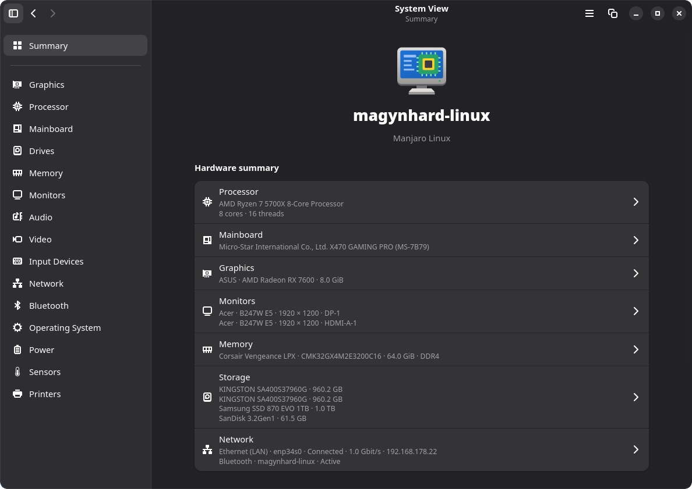

<div align="center">
  
</div>

# System View

[](https://github.com/magynhard/system-view.cr/releases)
[](https://crystal-lang.org/)
[](https://www.gtk.org/)
[](https://gnome.pages.gitlab.gnome.org/libadwaita/)
[](#requirements)
[](LICENSE)

System View is a native Linux application for exploring your computer's hardware
and system information. It brings your components, connected devices and useful
live readings together in a simple GTK4 and libadwaita interface.

> If you want a quick, easy-to-understand overview of what's inside your computer
> and what's connected to it, System View is for you.



## Features

- Start with a summary of your computer and open a component for more details.
- Explore your processor, graphics cards, mainboard, drives and memory.
- View monitors, audio devices, cameras, keyboards, mice and printers.
- Check network connections, Bluetooth devices, power supplies and sensors.
- See operating system, desktop environment and runtime information.
- Watch available values such as processor and graphics clocks, memory usage,
  temperatures and battery status update automatically.
- Copy the summary or all information, refresh the inventory, and open relevant
  GNOME Settings panels from the application.
- Use a responsive interface that follows your system's light or dark appearance
  and supports English and German.

The information shown depends on your hardware, drivers and system. Values that
cannot be determined are shown as unknown or not reported.

## Components at a glance

| Section | What you can see |
| --- | --- |
| Graphics | Graphics cards, video memory, clocks, load and graphics API details |
| Processor | Processor model, cores, threads, clocks and caches |
| Mainboard | Mainboard, firmware, boot mode and security information |
| Drives | Physical drives, capacity, connection and available health information |
| Memory | Installed and available memory, swap and memory module details |
| Monitors | Connected displays, resolution and refresh rates |
| Audio | Audio devices, the active sound server and default input and output |
| Video | Detected cameras and other video capture devices |
| Input Devices | Keyboards, mice, touchpads, game controllers and other input devices |
| Network | Ethernet and Wi-Fi connections, addresses and connection details |
| Bluetooth | Adapters and paired or connected devices |
| Operating System | Linux distribution, kernel, desktop and runtime environment |
| Power | Power adapters and battery status, charge and health |
| Sensors | Available temperature and fan readings |
| Printers | Printers configured with CUPS |

Standard information is read without administrator privileges. On native and
AppImage installations, you can choose to unlock additional processor and memory
details through the system's authorization dialog. This optional action is not
available in the standalone Flatpak.

## Requirements

Linux with Crystal **1.21+**, Shards, GTK **4.12+**, libadwaita **1.5+**,
GObject Introspection, gettext, pkg-config and standard C build tools. A graphical
session is required to run the application. A PCI ID database and the libdrm
`amdgpu.ids` database help identify graphics hardware. Printer discovery uses the
CUPS client library.

On Arch Linux / Manjaro:

```sh
sudo pacman -S --needed crystal shards gtk4 libadwaita gobject-introspection \
  gettext pkgconf base-devel gc pcre2 libyaml hwdata appstream desktop-file-utils
```

On Debian / Ubuntu 24.04 or newer:

```sh
sudo apt install build-essential pkg-config libgtk-4-dev libadwaita-1-dev \
  libgirepository1.0-dev gobject-introspection libgc-dev libpcre2-dev libyaml-dev \
  gettext pci.ids appstream desktop-file-utils
```

Install a compatible Crystal compiler and Shards separately if your distribution
ships an older version.

## Run

```sh
make setup
make run
```

`make setup` installs the Crystal dependencies and generates the GTK bindings.
To build and run the executable separately:

```sh
make build
./bin/system-view
```

To start the application in English regardless of the system language:

```sh
SYSTEM_VIEW_LANGUAGE=en ./bin/system-view
```

Use the header bar to copy information, refresh or open the About dialog.

| Shortcut | Action |
| --- | --- |
| Ctrl+R | Refresh hardware information |
| F9 | Show or hide the sidebar |
| F1 | About System View |
| Ctrl+W | Close the window |

## Install

Install the executable, desktop launcher, icon and translations for your user:

```sh
make install PREFIX="$HOME/.local"
```

Make sure `~/.local/bin` is on your `PATH`. For a system-wide installation, use
`sudo make install`. To remove the application, use the corresponding
`make uninstall PREFIX="$HOME/.local"` or `sudo make uninstall` command.

## Packages

Build an AppImage or a standalone Flatpak bundle with:

```sh
make appimage
make flatpak
```

The packages and their SHA-256 files are created in `dist/`. See
[Linux packaging](doc/packaging.md) for prerequisites, installation and release
details. The generated Flatpak manifest is intended for local builds, not a
Flathub submission.

## Development

Run the project checks with:

```sh
make test
make test-packaging
crystal tool format --check src/ spec/ tests/*.cr
make validate-metadata
python3 scripts/packaging.py verify
make build
make test-ui
git diff --check
```

The UI tests require Xvfb, `xvfb-run` and `dbus-run-session` and save screenshots
under `build/`. Translation catalogs are in `po/`; run `make generate_locales`
after changing translatable messages.

## Author and license

Created by [Matthäus J. N. Beyrle](https://github.com/magynhard).
Released under the [MIT License](LICENSE).
